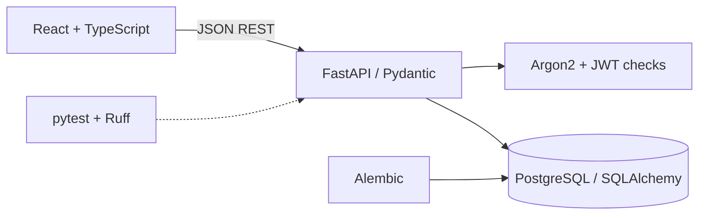

# AuthKit — FastAPI + React Authentication Scaffold

[](https://github.com/eskooo-a2fi/fastapi-react-auth-portfolio/actions/workflows/ci.yml)

**A full-stack authentication portfolio project** built with FastAPI, Pydantic v2, SQLAlchemy 2, PostgreSQL, React and TypeScript. It demonstrates API design, password hashing, JWT validation, database constraints and repeatable tests.

> **Local demonstration, not a public authentication service.** The client requires a running API and PostgreSQL database. Never use real credentials in demos. This project has not undergone a production security review.

## Architecture



## Key capabilities

| Area | Implementation |
| --- | --- |
| Registration | Validated email/password, password hashing, conflict handling and unique email constraint |
| Login | JSON endpoint plus OAuth2 form endpoint for FastAPI's Swagger UI |
| Protected profile | Bearer token validation checks signature, issuer, audience, expiry and active account status |
| Persistence | SQLAlchemy 2 models, PostgreSQL connection configuration, Alembic migration |
| Frontend | Typed React forms, loading/error states and in-memory token state |
| Quality gates | pytest API tests, Ruff linting and client build in GitHub Actions |

## Run locally

Requirements: **Python 3.11+**, **Docker/Compose** (or a running PostgreSQL server), and **Node 20.19+ / 22.12+**.

```bash
python -m venv .venv
source .venv/bin/activate       # Windows: .venv\Scripts\Activate.ps1
python -m pip install -r requirements-dev.txt
cp .env.example .env
# Set JWT_SECRET_KEY in .env to a new random value:
python -c 'import secrets; print(secrets.token_urlsafe(48))'
docker compose up -d postgres
alembic upgrade head
uvicorn app.main:app --reload
```

The generated secret is **not** automatically saved; paste it into your local `.env` file. Do not commit `.env` to GitHub. The local API docs are at <http://localhost:8000/docs>.

In another terminal:

```bash
cd client
npm install
npm run dev
```

Open the Vite URL (normally <http://localhost:5173>). The local React client calls `http://localhost:8000` by default. With no API running, the form cannot register or log in.

## API endpoints

| Method | Path | Behaviour |
| --- | --- | --- |
| GET | `/health` | Health check |
| POST | `/auth/register` | Create a user |
| POST | `/auth/login` | Receive short-lived access token |
| POST | `/auth/token` | OAuth2 form compatibility |
| GET | `/auth/me` | Return authenticated user profile |

## Tests and engineering trade-offs

```bash
python -m pytest -q
ruff check app tests
cd client && npm install && npm run build
```

Tests use **SQLite in memory** for fast isolation; they do not prove the PostgreSQL integration or migration pathway. Tokens are stored only in React state and disappear on refresh. No revocation or refresh-token flow is implemented. Before production use, add rate limiting, security monitoring, CSRF-aware session design, email verification, recovery, Postgres integration tests, rotation/revocation, security audits and HTTPS-only deployment.

## AI-assisted code review

[`CLAUDE_CODE_REVIEW.md`](CLAUDE_CODE_REVIEW.md) contains explicit prompts to review the endpoints for correctness, abuse cases, validation and security. Changes should be approved through tests and code review—not accepted purely because an AI suggests them.

## Evidence and edge cases

**CV keywords demonstrated:** **Python**, **FastAPI**, **Pydantic v2**, **PostgreSQL** configuration, **SQLAlchemy 2**, **Alembic** migrations, **RESTful APIs**, **Authentication (JWT)**, **React**, **TypeScript**, **pytest**, **Git/GitHub**, **CI/CD**, and **Claude Code** review prompts.

- `GET /health` is a liveness check; `GET /ready` executes a simple database query.
- Connection errors and exhausted SQLAlchemy pools return **503 Service Unavailable**, plus `Retry-After: 5`, without exposing SQL or connection information.
- The registration endpoint keeps its **409 Conflict** branch for duplicate addresses and uses a database unique constraint as a second line of defence.
- An inaccessible database does not make the liveness endpoint fail, but it correctly fails readiness and registration.
- `tests/test_service_outages.py` simulates an unavailable database and verifies recovery after the override is removed.

Run `python -m pytest -q` and `ruff check app tests` before pushing. CI tests against SQLite; PostgreSQL fault-recovery tests in a real deployment remain follow-up work.

**Not implemented:** SSO, refresh-token rotation, account recovery, rate limiting, or a production deployment. **Claude Code** is documented as a review workflow, not a claim that an autonomous agent audited or shipped this API.
